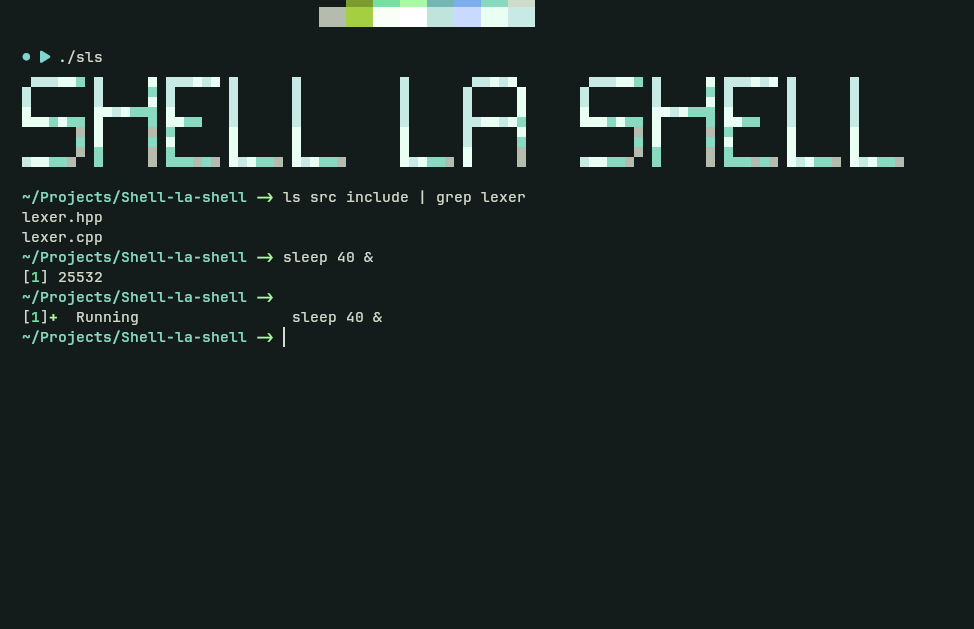

# Shell La Shell (SLS)



<p align="center">
  <strong>A small, colorful command-line shell written in C++.</strong><br>
  A hands-on project for exploring tokenization, processes, pipes, and shell basics.
</p>

---

## Features

| Area | Current support |
| --- | --- |
| Built-in commands | `echo`, `cd`, `pwd`, `type`, `declare`, `jobs`, `exit` |
| External programs | Finds executables through the `PATH` environment variable |
| Pipelines | Connects commands with `|` |
| Output redirection | `>` and `>>` |
| Error redirection | `2>` and `2>>` |
| Background processes | Start external commands with `&`; view tracked jobs with `jobs` |
| Variables | Shell-local variables with `$name` and `${name}` expansion |
| Input syntax | Single and double quotes, and basic backslash escaping |
| Startup | Colored Shell La Shell ASCII-art banner |

Example commands:

```sh
echo "Hello from Shell La Shell"
pwd
type echo
printf 'one\ntwo\n' | wc -l
echo hello > greeting.txt
echo again >> greeting.txt
sleep 2 &
jobs
```

Shell variables are assigned and inspected with `declare`:

```sh
declare greeting=hello
echo $greeting
echo ${greeting}
declare -p greeting
```

## Build and Run

### Requirements

- Linux or another Unix-like environment with POSIX process APIs
- Bash
- `g++` with C++17 support

From the repository root, build and launch the shell:

```sh
./build.sh
./sls
```

Exit the shell with:

```sh
exit
```

The build script compiles the implementation files in `src/`, uses headers from `include/`, and writes the executable as `sls` in the current working directory. The equivalent compiler command, when run from the repository root, is:

```sh
g++ -std=c++17 -Iinclude \
  src/main.cpp src/lexer.cpp src/executor.cpp src/utils.cpp \
  src/builtins.cpp src/declare.cpp src/redirection.cpp \
  src/jobs.cpp src/runPipeline.cpp \
  -o sls
```

## Clone

```sh
git clone https://github.com/Abdelwahab-Ibrahim/shell-la-shell.git Shell-la-shell
cd Shell-la-shell
./build.sh
./sls
```

## Technical Overview

- **Language and standard:** C++17, using the standard library for strings, vectors, streams, and filesystem operations.
- **Lexer:** `src/lexer.cpp` converts each input line into typed tokens for words, pipes, redirects, variable assignments, and substitutions.
- **Command dispatch:** Built-ins run in the shell process where needed, while external commands are located through `PATH` and started with `fork` and `execv`.
- **Pipelines:** `src/runPipeline.cpp` creates Unix pipes and child processes, connects their standard input/output, and waits for the pipeline children.
- **Redirection:** `src/redirection.cpp` uses file descriptors and `open`/`dup2` to redirect standard output and standard error.
- **Background jobs:** `src/jobs.cpp` tracks background process IDs and checks completion with non-blocking `waitpid` calls.
- **Project layout:** C++ implementations live in `src/`; shared declarations and headers live in `include/`.

## Current Limitations

Shell La Shell was built as a learning project following the staged requirements of CodeCrafters' [Build Your Own Shell](https://app.codecrafters.io/courses/shell) course. Its scope reflects those exercises; it is not intended to implement every feature of POSIX shells or Bash, and it should not be treated as a fully compatible replacement. Features beyond the course scope that are not currently implemented include:

- Redirection covers standard output and standard error; input redirection with `<` is not implemented.
- The parser handles a small set of operators and quoting rules. It does not provide the full shell grammar, such as command lists, conditionals, loops, or subshells.
- Variable expansion is limited to variables created inside this shell; environment-variable expansion and full expansion rules are not implemented.
- External command lookup searches `PATH`; shell-language features such as glob expansion, command substitution, and sourcing script files are not implemented.
- Background-job support is basic. There are no `fg`, `bg`, or `wait` commands, and job notifications are updated when the shell checks its job list.
- Exit status and signal handling do not yet match the behavior of a mature shell.

## Possible Next Steps

- Add command history with a `history` command, plus Up/Down arrow navigation to recall previous commands; optionally persist history between shell sessions.
- Add interactive line editing so Left/Right arrows move the cursor within the current command, with useful editing shortcuts such as Home, End, and Backspace.
- Add Tab completion for built-in commands, executables found through `PATH`, and file or directory paths.
- Improve interactive input handling so completion and cursor editing work together reliably, including terminal resize and Unicode-aware cursor positions.

## Project Structure

```text
.
├── build.sh
├── include/       # Headers and shared declarations
├── src/           # Shell implementation
└── README.md
```